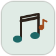
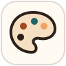
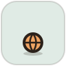
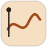
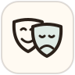
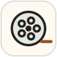
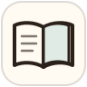
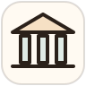
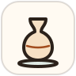

  

<h1 align="center">Balcony Museum · 발코니 미술관</h1>

  <b>날마다 전시가 바뀌는 작은 미술관</b> 
  어느 날은 미술, 어느 날은 체육, 어느 날은 음악. 
  발코니에 서서 오늘의 전시를 구경하고 가세요.

  <a href="https://balconymuseum.com">🌐 balconymuseum.com</a>

---

## 🎟️ 최근 전시

### 🎶 보사노바 · 삼바 · 탱고 60분 감상회 (지난 감상회)

| | |
|---|---|
| **주제** | 음악 |
| **감상회** | 2026년 10월 23일 (금), 마침 |
| **전시 자료** | [balconymuseum.com/exhibits/bossa-nova](https://balconymuseum.com/exhibits/bossa-nova/) |

브라질의 삼바와 보사노바, 아르헨티나의 탱고를 60분 동안 함께 들은 감상회입니다. 감상회에 쓴 자료는 지금도 한 페이지에서 볼 수 있습니다.

- 오늘 틀 곡 플레이리스트와 60분 해설 스크립트
- 아티스트 노트 13편: 톰 조빔, 주앙 질베르토, 바덴 파웰, 아스토르 피아졸라 등
- 곡마다 YouTube 링크, 조빔 노트에는 Spotify 앨범 서가

---

## 🖼️ 전시관 안내

전시는 주제를 바꿔 가며 열립니다. 아래 전시관이 차례로 문을 엽니다.

<table>
  <tr>
    <td align="center"> <b>음악</b> Music</td>
    <td align="center"> <b>미술</b> Painting</td>
    <td align="center"> <b>체육</b> Sports</td>
    <td align="center"> <b>무용</b> Dance</td>
    <td align="center"> <b>연극</b> Theater</td>
  </tr>
  <tr>
    <td align="center"> <b>영화</b> Film</td>
    <td align="center"> <b>사진</b> Photography</td>
    <td align="center"> <b>문학</b> Literature</td>
    <td align="center"> <b>건축</b> Architecture</td>
    <td align="center"> <b>공예</b> Ceramics</td>
  </tr>
</table>

---

## 🗂️ 지난 전시

| 전시 | 주제 | 위치 |
|---|---|---|
| 그래픽 디자인 & 일러스트 컨설팅 | 미술 · 디자인 | [`exhibits/graphic-design/`](exhibits/graphic-design/) |

---

## 🛠️ 구성

이 저장소는 **로비(첫 화면)** 만 담고 있습니다. 각 전시는 따로 관리하며, 같은 도메인의 하위 경로로 연결됩니다.

| 파일 | 역할 |
|---|---|
| `index.html` | 로비. 직접 쓴 정적 페이지 한 장. 예전 감상회 링크(`#/…`)는 새 주소로 넘겨 줍니다 |
| `favicon.svg`, `favicon.js` | 움직이는 탭 아이콘 (해와 물결) |
| `assets/readme/` | 로비와 이 README의 배너와 전시관 아이콘 |
| `exhibits/graphic-design/` | 지난 전시 (컨설팅 안내) |

로컬에서 보려면 `python -m http.server 8051` 후 `http://localhost:8051`에 접속하세요.

---

배너와 아이콘은 이 프로젝트를 위해 직접 그린 SVG 애니메이션입니다.

