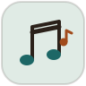
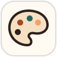
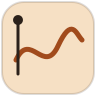
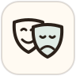
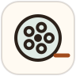
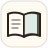
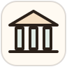
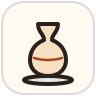

<p align="center">
  
</p>

<h1 align="center">Balcony Museum · 발코니 미술관</h1>

<p align="center">
  <b>날마다 전시가 바뀌는 작은 미술관</b><br>
  어느 날은 미술, 어느 날은 체육, 어느 날은 음악.<br>
  발코니에 서서 오늘의 전시를 구경하고 가세요.
</p>

<p align="center">
  <a href="https://balconymuseum.com">🌐 balconymuseum.com</a>
</p>

---

## 🎟️ 지금 전시 중

### 🎶 보사노바 · 삼바 · 탱고 60분 감상회

| | |
|---|---|
| **주제** | 음악 |
| **감상회** | 2026년 10월 23일 (금) |
| **바로 가기** | [balconymuseum.com](https://balconymuseum.com) |

브라질의 삼바와 보사노바, 아르헨티나의 탱고를 60분 동안 함께 듣는 감상회입니다. 감상회 전에 미리 둘러보실 수 있도록 다음을 한 페이지에 모았습니다.

- 오늘 틀 곡 플레이리스트와 60분 해설 스크립트
- 아티스트 노트 14편: 톰 조빔, 주앙 질베르토, 바덴 파웰, 아스토르 피아졸라 등
- 곡마다 YouTube 링크, 조빔 노트에는 Spotify 앨범 서가

---

## 🖼️ 전시관 안내

전시는 주제를 바꿔 가며 열립니다. 아래 전시관이 차례로 문을 엽니다.

<table>
  <tr>
    <td align="center"><br><b>음악</b><br><sub>Music</sub></td>
    <td align="center"><br><b>미술</b><br><sub>Painting</sub></td>
    <td align="center"><br><b>체육</b><br><sub>Sports</sub></td>
    <td align="center"><br><b>무용</b><br><sub>Dance</sub></td>
    <td align="center"><br><b>연극</b><br><sub>Theater</sub></td>
  </tr>
  <tr>
    <td align="center"><br><b>영화</b><br><sub>Film</sub></td>
    <td align="center"><br><b>사진</b><br><sub>Photography</sub></td>
    <td align="center"><br><b>문학</b><br><sub>Literature</sub></td>
    <td align="center"><br><b>건축</b><br><sub>Architecture</sub></td>
    <td align="center"><br><b>공예</b><br><sub>Ceramics</sub></td>
  </tr>
</table>

---

## 🗂️ 지난 전시

| 전시 | 주제 | 위치 |
|---|---|---|
| 그래픽 디자인 & 일러스트 포트폴리오 | 미술 · 디자인 | [`backup/`](backup/) |

---

## 🛠️ 만드는 방법

현재 전시 페이지는 폴더 안의 Markdown 문서들을 이어 붙여 `index.html` 한 장으로 만듭니다.

```bash
python build_site.py                 # index.html 생성
python build_site.py --check-online  # 유튜브 링크가 살아 있는지도 확인
```

| 파일 | 역할 |
|---|---|
| `*.md` | 감상회 프로그램, 해설 스크립트, 아티스트 노트 원고 |
| `build_site.py` | Markdown을 서로 연결해 `index.html`로 빌드 |
| `favicon.svg`, `favicon.js` | 움직이는 탭 아이콘 (해와 물결) |
| `assets/readme/` | 이 README의 배너와 전시관 아이콘 |
| `backup/` | 지난 전시 |

로컬에서 보려면 `index.html`을 바로 열거나 `python -m http.server 8051` 후 `http://localhost:8051`에 접속하세요.

---

<p align="center"><sub>README의 배너와 아이콘은 이 프로젝트를 위해 직접 그린 SVG 애니메이션입니다.</sub></p>
